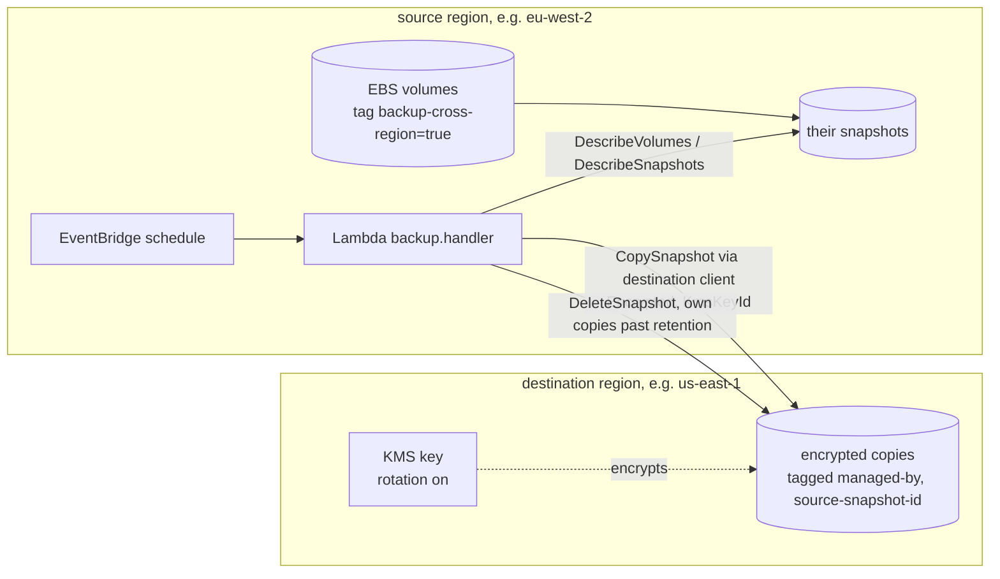

# Cross-region EBS snapshot backup (Terraform + Lambda)

A Terraform module and a small Lambda function that copy the latest snapshot
of every tagged EBS volume to a second AWS region on a schedule, encrypted
with a KMS key that lives in that destination region. Old copies are pruned
by a retention rule, and the function is **dry-run by default**.

> **Status:** AWS EBS only. **Azure managed disks are not implemented.**
> The Lambda logic is covered by 20 pytest tests with fake EC2 clients
> (pagination, idempotency, errored and pending copies, copy cap and AWS
> copy-limit handling, retention, dry run). The Terraform module is covered by 6 `terraform test` runs
> against mocked providers, including four rejected inputs. The example root
> passes `terraform validate`. **Nothing has been planned or applied in
> AWS**, and the function has never run against real snapshots.

## Problem

> Build a Terraform + Lambda solution that automatically backs up critical
> EBS volumes / managed disks to a secondary region on a schedule with
> encryption.

## How it works



Each run:

1. Lists volumes with the opt-in tag (`backup-cross-region=true` by default),
   following `NextToken`.
2. Finds the latest **completed** snapshot of each. Creating the snapshots is
   out of scope; use Data Lifecycle Manager or AWS Backup for that.
3. Skips any snapshot that already has a **pending or completed** copy in
   the destination (looked up by the `source-snapshot-id` tag). A copy in
   state `error` doesn't count: it is logged as a warning, listed under
   `errored_copies` in the run summary, and the snapshot is copied again.
4. Calls `CopySnapshot` on a destination-region client with `Encrypted=true`
   and the destination key, tagging the copy as it is created.
5. Starts at most `max_copies_per_run` copies (default 5). If AWS answers
   `ResourceLimitExceeded`, the remaining snapshots are reported as
   `deferred` and picked up next run; any other error fails the run.
6. **Retention:** deletes copies tagged `managed-by=cross-region-backup`
   that are older than `retention_days`, but **always keeps the newest
   completed copy of each volume** (even if the volume is gone) and never
   deletes a pending copy. An errored copy never counts as the one to keep. Snapshots it didn't make are
   never touched (the IAM policy enforces the same by tag).

7. **Errored copies fail the invocation.** If any copy in state `error` was
   seen, the function first finishes everything else (new copies, retries,
   retention), logs the summary, and then raises `CopyErrors`. The Lambda
   invocation is marked failed, so a CloudWatch alarm on the function's
   `Errors` metric can page someone.

With `dry_run = true` (the default) the function only reports what it would
copy and delete.

## Terraform

The module needs two provider configurations, passed as `aws.source` and
`aws.destination`:

```hcl
provider "aws" {
  alias  = "source"
  region = "eu-west-2"
}
provider "aws" {
  alias  = "destination"
  region = "us-east-1"
}

module "backup" {
  source    = "github.com/zeinhaidara/42-terraform-lambda-cross-region-backup"
  providers = { aws.source = aws.source, aws.destination = aws.destination }

  schedule_expression = "rate(6 hours)"
  retention_days      = 14
  dry_run             = true
}
```

| Input | Default | Notes |
|---|---|---|
| `schedule_expression` | `rate(6 hours)` | must be `rate(...)` or `cron(...)` |
| `backup_tag_key` / `backup_tag_value` | `backup-cross-region` / `true` | opt-in tag |
| `retention_days` | `14` | 1-365 |
| `max_copies_per_run` | `5` | 1-20 |
| `dry_run` | `true` | set `false` to copy and delete |
| `source_kms_key_arns` | `[]` | keys of encrypted source volumes, needed to read them |

A precondition stops the plan if both providers point at the same region.

### Who can use the destination key

The key policy has two statements:

- **The account root principal (`kms:*`).** This is the standard statement
  that lets IAM policies in the account grant key access. Administrators can
  manage the key, and anyone you grant `kms:*` actions in IAM can use it.
- **The backup function's role**, for encrypt, decrypt, re-encrypt, data
  keys, describe and `CreateGrant`, **only when the call comes through EC2
  in the destination region** (`kms:ViaService = ec2.<region>.amazonaws.com`).
  The role can't use the key directly.

Nobody else can decrypt the copies by default. To **restore** a volume from
a copy, the person or role doing it needs IAM permission for
`kms:CreateGrant`, `kms:Decrypt` and `kms:DescribeKey` on this key. Grant
that deliberately, for example to a break-glass DR role.

### Lambda permissions

Least privilege: describe volumes and snapshots, `CopySnapshot`,
`CreateTags` only while creating a copy, `DeleteSnapshot` only on
snapshots tagged `managed-by=cross-region-backup`, use of the destination
key, its own log group, and (optionally) decrypt on the source volume keys.
No wildcard actions; a test checks this.

## Usage

```bash
python -m pip install -r requirements-dev.txt
python -m ruff check .
python -m ruff format --check .
python -m pytest -q

terraform fmt -check -recursive
terraform init -backend=false
terraform test

cd examples/basic
terraform init -backend=false -lockfile=readonly
terraform validate
```

The module itself is checked with `terraform test` rather than
`terraform validate`: a module that declares `configuration_aliases` has no
provider configuration of its own, so `validate` only runs cleanly from a
root that passes providers in (`examples/basic`). CI also fails if
`terraform test` reports zero passed runs.

## Limits

- AWS EBS only; Azure managed disks are not implemented.
- **AWS caps concurrent snapshot copies per destination region** (documented
  as 20 at the time of writing; AWS behaviour to re-verify). The function
  caps its own starts per run and defers on `ResourceLimitExceeded`.
- Copies only the latest snapshot per volume per run, not every snapshot.
  Errored copies of older snapshots are therefore not detected.
- Copies of large or first-time snapshots can take hours; the function
  starts them and does not wait.
- Single account. Cross-account copies need key and snapshot sharing, not
  built here.
- Copies cost storage in the destination region plus cross-region data
  transfer.

## Security notes

- Copies are always encrypted with a customer-managed key in the
  destination region, with rotation on.
- Delete permission is limited by tag to the function's own copies, and the
  code never deletes a volume's newest copy.
- Dry run is the default in both Terraform (`dry_run = true`) and the
  function (`DRY_RUN` unset means true).
- No credentials in the repo; IDs are placeholders.

## Idempotency

Re-running the function is safe: a snapshot whose copy is pending or
completed is skipped, so a copy still in progress from an earlier run is not
started twice. A copy in state `error` is the one exception: it doesn't count
as done, so the run copies the snapshot again. Errored copies are found while
checking each volume's **latest** snapshot, and every run that finds one fails
its invocation, even after the retry succeeded, until someone deletes the
errored copy or it ages out under retention. That is deliberate: an alarm
keeps firing until a person has looked. Retention only removes copies past
their age. Re-applying the Terraform with the same inputs is a no-op.
